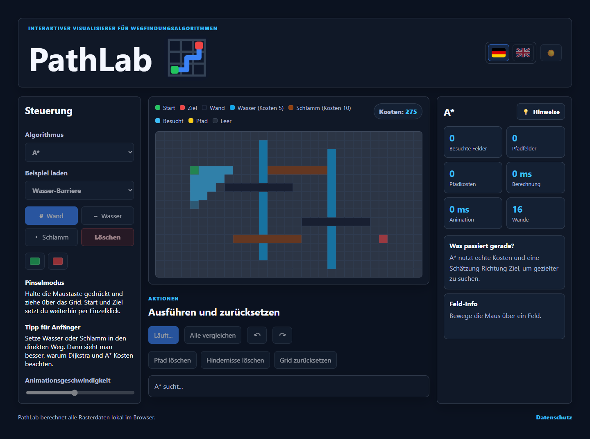

# PathLab

**Deutsch** | [English](README_EN.md)

Zeichne Wände, Wasser und Schlamm auf ein Raster mit 17 × 31 Feldern. Beobachte, welche Felder ein Suchalgorithmus besucht, oder vergleiche alle vier auf demselben Raster.

[Live-Demo öffnen](https://alekszyro.github.io/PathLab/) · [Benutzeranleitung](BENUTZERANLEITUNG_DE.md)



## Algorithmen und Kosten

BFS findet einen Weg mit den wenigsten Schritten. DFS folgt einem Suchzweig in die Tiefe und garantiert keine minimale Weglänge. Für beide kann ein kurzer Weg durch teures Gelände führen. Dijkstra und A* minimieren die Summe der Eintrittskosten. Ein normales Feld kostet 1, Wasser 5 und Schlamm 10. Der Start kostet nichts. A* nutzt die Manhattan-Distanz zum Ziel.

Starte mit einem Beispielraster oder setze Start und Ziel selbst. Rasteränderungen lassen sich rückgängig machen und wiederholen. Die Anzeige trennt Rechenzeit und Animationsdauer. [Suchanimation ansehen](docs/screenshots/pathlab-demo.webp)

## Lokal starten

Mit einer aktuellen Node.js-22-LTS-Version:

```sh
npm ci
npm run dev
```

Die Suchalgorithmen laufen unabhängig von React. `npm run check` führt ESLint und Vitest aus. `npm run build` erstellt die statische Anwendung, `npm run preview` startet die lokale Vorschau.

[MIT-Lizenz](LICENSE) · [Portfolio](https://aleksandar-nikolic.ch/)
