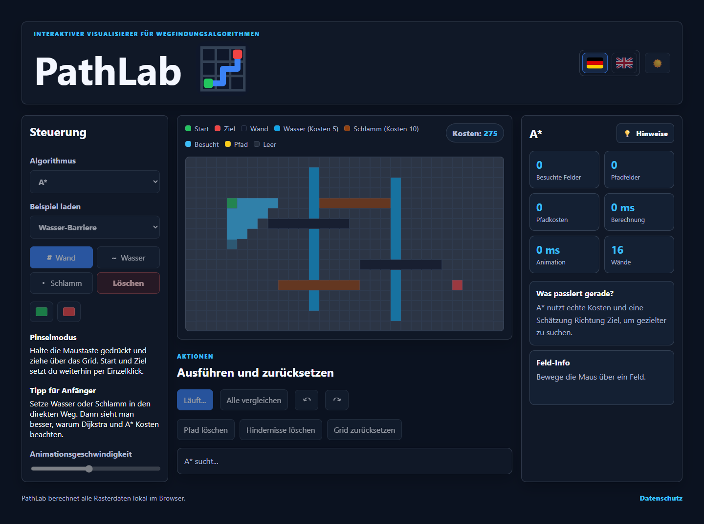

# PathLab

[Deutsch](README.md) | **English**

Draw walls, water and mud on a 17 × 31 grid. Watch a search unfold or compare all four algorithms on the same terrain.

[Open the live demo](https://alekszyro.github.io/PathLab/) · [User guide](USER_GUIDE_EN.md)



## Algorithms and costs

BFS finds a route with the fewest steps. DFS explores one branch at a time and can take a longer route. Either can cross expensive terrain. Dijkstra and A* minimise the total cost of entering cells. Normal cells cost 1, water costs 5 and mud costs 10. The starting cell is free. A* uses Manhattan distance to estimate the remaining cost.

Try a preset or move the endpoints yourself. Board edits support undo and redo. The results show computation time separately from animation duration. [Watch a search](docs/screenshots/pathlab-demo.webp)

## Run locally

Use a current Node.js 22 LTS release:

```sh
npm ci
npm run dev
```

The search algorithms run independently of React. `npm run check` runs ESLint and Vitest. Build the static app with `npm run build` and serve it locally with `npm run preview`.

[MIT licence](LICENSE) · [Portfolio](https://aleksandar-nikolic.ch/)
